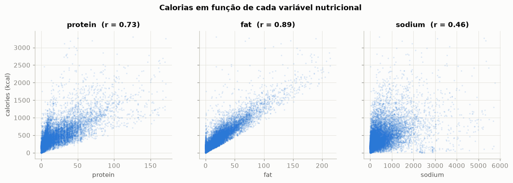
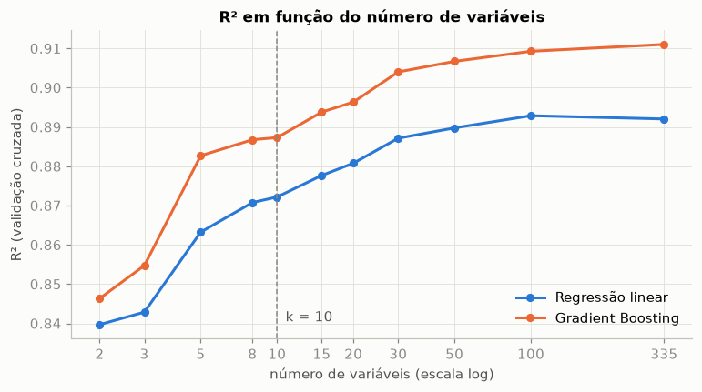
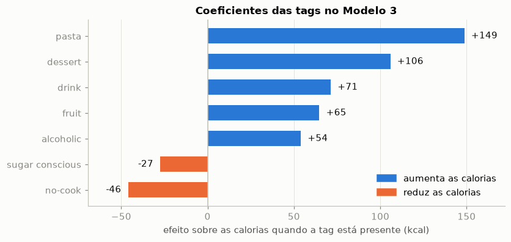
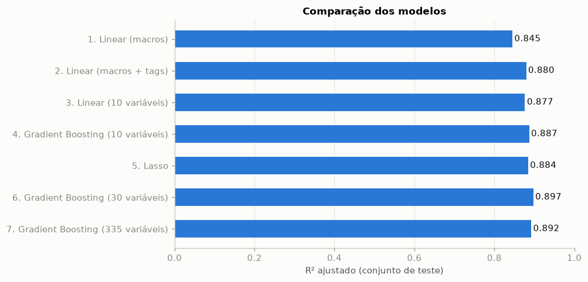
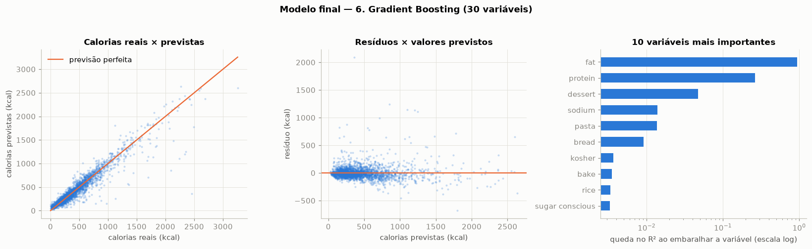

# Previsão de calorias de receitas

**Atividade de Machine Learning** · Regressão · Dataset [Epicurious](https://www.kaggle.com/datasets/hugodarwood/epirecipes) (Kaggle) · Notebook: [calorias_epicurious.ipynb](calorias_epicurious.ipynb)

> **Resultado.** Um modelo de Gradient Boosting com 30 variáveis prevê as calorias de uma receita com **R² = 0,898** e **R² ajustado = 0,897** em dados que ele nunca viu, errando em média 66 kcal por receita.

| | |
|---|---|
| **Problema** | Prever as calorias (`calories`) de uma receita |
| **Dados** | 20.052 receitas, 680 colunas; 14.096 receitas após a limpeza |
| **Modelos testados** | 7, do mais simples ao mais completo |
| **Modelo final** | Gradient Boosting com 30 variáveis |
| **Métrica principal** | R² ajustado no conjunto de teste |

## Sumário

1. [A ideia central](#1-a-ideia-central)
2. [Os dados](#2-os-dados)
3. [Por que prever calorias](#3-por-que-prever-calorias)
4. [Preparação dos dados](#4-preparação-dos-dados)
5. [Os modelos, passo a passo](#5-os-modelos-passo-a-passo)
6. [Parte extra: modelos com mais variáveis](#6-parte-extra-modelos-com-mais-variáveis)
7. [Comparação](#7-comparação)
8. [Modelo final](#8-modelo-final)
9. [O resultado é bom?](#9-o-resultado-é-bom)
10. [Limitações](#10-limitações)
11. [Como executar](#11-como-executar)

## 1. A ideia central

As calorias de um alimento vêm de três macronutrientes. Pelos fatores de Atwater:

| Macronutriente | Energia | Está no dataset? |
|---|---|---|
| Gordura | 9 kcal por grama | Sim (`fat`) |
| Proteína | 4 kcal por grama | Sim (`protein`) |
| Carboidrato | 4 kcal por grama | **Não** |

O dataset tem gordura e proteína, mas **não tem carboidratos**. Todo o trabalho gira em torno disso:

1. Gordura e proteína sozinhas já explicam 84% da variância das calorias.
2. O que falta é a parte dos carboidratos.
3. As tags da receita (`pasta`, `dessert`, `rice`…) indicam indiretamente se ela tem muito carboidrato.
4. Usando as tags certas, o modelo chega a 90%.

## 2. Os dados

O arquivo `epi_r.csv` tem 20.052 receitas do site Epicurious e 680 colunas:

| Colunas | Descrição |
|---|---|
| `title` | Nome da receita |
| `rating` | Nota dos usuários (0 a 5) |
| `calories`, `protein`, `fat`, `sodium` | Calorias (kcal), proteína (g), gordura (g) e sódio (mg) |
| 674 tags | Etiquetas da receita, em formato binário (0/1) |

### O que são as tags

As tags são etiquetas que o site atribui a cada receita para classificá-la. No dataset, cada tag virou uma coluna: o valor é 1 se a receita tem aquela etiqueta e 0 se não tem.

| Tipo de tag | Exemplos |
|---|---|
| Ingrediente | `pasta`, `rice`, `chicken`, `tomato` |
| Tipo de prato | `dessert`, `drink`, `salad`, `side` |
| Dieta ou restrição | `vegetarian`, `sugar conscious`, `low carb` |
| Técnica de preparo | `bake`, `grill`, `no-cook` |
| Ocasião ou estação | `christmas`, `summer`, `dinner` |
| Origem da receita | `bon appétit`, `gourmet` (revistas) |

Exemplo: a receita "Lentil, Apple, and Turkey Wrap" tem as tags `apple`, `bean`, `fruit`, `kid-friendly`, `lentil`, `lettuce`, `sandwich`, `tomato`, `turkey`, `vegetable` e `cookie`.

## 3. Por que prever calorias

As duas candidatas a variável-alvo eram `rating` e `calories`. A correlação de Spearman com as outras variáveis decide:

| | `rating` | `calories` |
|---|---|---|
| `protein` | 0,09 | 0,78 |
| `fat` | 0,12 | 0,86 |
| `sodium` | 0,10 | 0,55 |

- **`rating`** não tem relação com nada. A nota depende de gosto pessoal, que os dados não capturam; qualquer modelo teria R² baixo.
- **`calories`** tem relação forte com gordura e proteína, e essa relação tem explicação física.



## 4. Preparação dos dados

### Limpeza

| Etapa | Receitas restantes | Motivo |
|---|---|---|
| Dados originais | 20.052 | |
| Remoção de duplicatas | 18.251 | Uma receita repetida no treino e no teste faria o modelo "ver" a resposta (vazamento de dados) |
| Remoção de valores ausentes | 14.446 | Não se imputa a variável-alvo, e imputar os macronutrientes criaria valores inventados |
| Remoção de outliers (acima do percentil 99) | 14.096 | Erros de cadastro: o máximo de `calories` era 30 milhões de kcal |

### Pré-seleção das tags

Das 674 tags, 332 seguiram para a modelagem:

- Tags com menos de 50 receitas saíram, por falta de dados para estimar seu efeito.
- A tag `low cal` saiu porque é definida a partir da própria variável-alvo (vazamento de informação).

### Divisão e validação

- 80% treino (11.276 receitas) e 20% teste (2.820 receitas), com `random_state=42`.
- Validação cruzada de 5 folds dentro do treino, para cada modelo.
- O conjunto de teste só é usado na avaliação final.

### Métrica

Como os modelos têm números de variáveis muito diferentes (de 3 a 335), a comparação usa o **R² ajustado**, que penaliza variáveis que não agregam informação:

$$R^2_{aj} = 1 - (1 - R^2)\,\frac{n - 1}{n - p - 1}$$

em que *n* é o número de observações (2.820 no teste) e *p* o número de variáveis.

## 5. Os modelos, passo a passo

Os modelos formam uma sequência. Cada um responde a uma pergunta, e a resposta leva ao seguinte.

| Passo | Modelo | Variáveis | Pergunta |
|---|---|---|---|
| 1 | Regressão linear | 3 | Quanto dá para explicar só com os macronutrientes? |
| 2 | Regressão linear com todas as tags | 335 | As tags melhoram o modelo? |
| — | Seleção de variáveis (Lasso) | 335 → 10 | Quais variáveis realmente importam? |
| 3 | Regressão linear reduzida | 10 | Dá para manter o resultado com poucas variáveis? |
| 4 | Gradient Boosting reduzido | 10 | Um modelo não linear faz melhor? |

### Modelo 1 — Regressão linear com macronutrientes

**O que é.** Uma regressão linear por mínimos quadrados. É o modelo de referência.

**Variáveis e motivo.** `protein`, `fat` e `sodium`: são as únicas variáveis numéricas do dataset e têm relação física direta com as calorias. O sódio não fornece energia, mas indica o tamanho e o tipo da receita.

```
calories = 109,1 + 3,58 × protein + 10,02 × fat + 0,037 × sodium
```

| R² treino | R² validação cruzada | R² teste | R² ajustado teste | MAE |
|---|---|---|---|---|
| 0,843 | 0,843 ± 0,013 | 0,845 | 0,845 | 95 kcal |

**O que aprendemos.** Três variáveis já explicam 84% da variância, e os coeficientes ficam perto dos valores teóricos (9 e 4 kcal/g). O intercepto de 109 kcal é a média das calorias que vêm dos carboidratos, que o modelo não enxerga.

**Próximo passo.** Dar ao modelo alguma informação sobre carboidratos: as tags.

### Modelo 2 — Regressão linear com todas as tags

**O que é.** A mesma regressão linear, com as tags como variáveis adicionais.

**Variáveis e motivo.** Os 3 macronutrientes e as 332 tags. Entram todas, sem escolha manual, para testar a hipótese de que as tags carregam a informação de carboidratos sem que a decisão do analista influencie o resultado.

| R² treino | R² validação cruzada | R² teste | R² ajustado teste | MAE |
|---|---|---|---|---|
| 0,900 | 0,892 ± 0,009 | 0,894 | 0,880 | 68 kcal |

**O que aprendemos.** As tags funcionam: o R² de teste sobe de 0,845 para 0,894, e o teste F parcial confirma que elas contribuem em conjunto (F = 18,7; p ≈ 0). Mas só 107 das 332 são individualmente significativas, e por isso o R² ajustado (0,880) fica abaixo do R².

**Próximo passo.** Descobrir quais variáveis realmente importam.

### Seleção de variáveis com Lasso

O **Lasso** é uma regressão linear com penalidade L1, que zera os coeficientes das variáveis pouco úteis. Quanto mais forte a penalidade, menos variáveis sobram. Diminuindo a penalidade aos poucos, as variáveis entram no modelo da mais importante para a menos importante, e essa ordem serve de ranking. A seleção usa somente os dados de treino.



O ganho se concentra nas primeiras variáveis; depois a curva achata. Com **10 variáveis**, reduz-se o modelo em 97% em troca de cerca de 2 pontos percentuais de R².

### Modelo 3 — Regressão linear reduzida

**O que é.** Regressão linear com as 10 primeiras variáveis do ranking.

**Variáveis e motivo.** Foram escolhidas pelos dados, e não à mão. Além dos macronutrientes, todas as tags indicam carboidrato ou álcool, a informação que falta no dataset.

| # | Variável | Por que entra no modelo |
|---|---|---|
| 1 | `fat` | Gordura: 9 kcal por grama |
| 2 | `protein` | Proteína: 4 kcal por grama |
| 3 | `sodium` | Indica o tamanho e o tipo da receita |
| 4 | `pasta` | Massa: muito carboidrato |
| 5 | `dessert` | Sobremesa: muito açúcar |
| 6 | `fruit` | Fruta: açúcar natural |
| 7 | `sugar conscious` | Receita com pouco açúcar |
| 8 | `alcoholic` | Álcool fornece cerca de 7 kcal por grama e não aparece em nenhuma outra coluna |
| 9 | `drink` | Bebida: calorias vêm de açúcar ou álcool |
| 10 | `no-cook` | Receitas sem cozimento (saladas, molhos): pouco carboidrato |

```
calories = 63,5
         + 9,87 × fat + 3,99 × protein + 0,051 × sodium
         + 148,7 × pasta + 105,8 × dessert + 71,3 × drink + 64,7 × fruit + 54,0 × alcoholic
         − 27,4 × sugar conscious − 46,0 × no-cook
```

As tags valem 0 ou 1, então cada coeficiente de tag é o número de kcal somado ou subtraído quando a receita tem aquela etiqueta.



| R² treino | R² validação cruzada | R² teste | R² ajustado teste | MAE |
|---|---|---|---|---|
| 0,872 | 0,872 ± 0,012 | 0,877 | 0,877 | 79 kcal |

**O que aprendemos.** Todas as 10 variáveis são significativas (p < 0,001). Os coeficientes de gordura (9,87) e proteína (3,99) praticamente coincidem com os valores teóricos. Treino, validação cruzada e teste dão o mesmo R²: não há overfitting.

**Próximo passo.** A regressão linear supõe que cada variável soma um valor fixo. Testar um modelo não linear com as mesmas variáveis.

### Modelo 4 — Gradient Boosting reduzido

**O que é.** Um conjunto de árvores de decisão construídas em sequência, em que cada árvore corrige os erros das anteriores. Captura não linearidades e interações entre variáveis.

**Variáveis e motivo.** As mesmas 10 do modelo 3. Manter as variáveis fixas e trocar só o algoritmo torna a comparação justa: a diferença vem do tipo de modelo, e não das variáveis.

| R² treino | R² validação cruzada | R² teste | R² ajustado teste | MAE |
|---|---|---|---|---|
| 0,914 | 0,887 ± 0,010 | 0,887 | 0,887 | 73 kcal |

**O que aprendemos.** O modelo não linear ganha 1 ponto percentual sobre o linear com as mesmas variáveis. O ganho é pequeno, o que indica que a relação é essencialmente linear.

**Próximo passo.** Ver quanto se ganharia abrindo mão da simplicidade.

## 6. Parte extra: modelos com mais variáveis

Os modelos 3 e 4 priorizam a simplicidade. Estes três mostram o outro lado da troca.

| Modelo | Variáveis | Pergunta |
|---|---|---|
| 5. Lasso | 245 | Qual o melhor modelo linear possível com as tags? |
| 6. Gradient Boosting | 30 | Um meio-termo entre 10 e 335 compensa? |
| 7. Gradient Boosting | 335 | Qual o teto de desempenho com estes dados? |

### Modelo 5 — Lasso

**O que é.** O Lasso usado como modelo de previsão: recebe as 335 variáveis, e a validação cruzada escolhe a força da penalidade que dá o melhor desempenho (α = 0,754).

**Variáveis e motivo.** Ficam 245: os 3 macronutrientes e 242 tags. A escolha é feita pelo próprio modelo, com o único critério de prever bem.

| R² treino | R² validação cruzada | R² teste | R² ajustado teste | MAE |
|---|---|---|---|---|
| 0,898 | 0,893 ± 0,010 | 0,894 | 0,884 | 67 kcal |

**O que aprendemos.** É o melhor dos modelos lineares, mas supera o modelo 3 em apenas 0,007 de R² ajustado usando 245 variáveis em vez de 10.

### Modelo 6 — Gradient Boosting com 30 variáveis

**O que é.** O Gradient Boosting do modelo 4, com as 30 primeiras variáveis do ranking.

**Variáveis e motivo.** Na curva de validação cruzada, o R² sobe de 0,887 para 0,904 entre 10 e 30 variáveis e depois quase não muda. O valor 30 é o ponto em que a curva começa a achatar.

| Grupo | Variáveis | O que indicam |
|---|---|---|
| Macronutrientes (3) | `fat`, `protein`, `sodium` | Gordura, proteína e tamanho da receita |
| Fontes de carboidrato (6) | `pasta`, `rice`, `potato`, `sweet potato/yam`, `bread`, `bean` | Amido |
| Sobremesas e doces (3) | `dessert`, `cake`, `cookies` | Açúcar |
| Frutas (5) | `fruit`, `pear`, `prune`, `cranberry`, `dried fruit` | Açúcar natural |
| Bebidas e álcool (2) | `drink`, `alcoholic` | Calorias de açúcar ou álcool |
| Dieta (4) | `sugar conscious`, `low carb`, `kidney friendly`, `kosher` | Restrições que mudam a composição da receita |
| Preparo (4) | `no-cook`, `bake`, `marinate`, `quick & easy` | Tipo de receita |
| Outras (3) | `salad`, `garlic`, `fall` | Pratos leves, pratos salgados e receitas de outono |

| R² treino | R² validação cruzada | R² teste | R² ajustado teste | MAE |
|---|---|---|---|---|
| 0,932 | 0,904 ± 0,010 | 0,898 | **0,897** | 66 kcal |

**O que aprendemos.** É o **maior R² ajustado de todo o trabalho**.

### Modelo 7 — Gradient Boosting com todas as variáveis

**O que é.** O mesmo Gradient Boosting, com as 335 variáveis e sem nenhuma seleção.

**Variáveis e motivo.** Todas. Serve de teto de referência: é o máximo que se extrai destes dados.

| R² treino | R² validação cruzada | R² teste | R² ajustado teste | MAE |
|---|---|---|---|---|
| 0,943 | 0,911 ± 0,009 | **0,905** | 0,892 | 62 kcal |

**O que aprendemos.** Tem o maior R² bruto, mas as 305 variáveis a mais melhoram o R² em apenas 0,007. Isso não compensa a penalização, e o R² ajustado (0,892) fica abaixo do modelo 6.

## 7. Comparação



| Modelo | Variáveis | R² teste | R² ajustado teste | MAE |
|---|---|---|---|---|
| 1. Regressão linear (macronutrientes) | 3 | 0,845 | 0,845 | 95 kcal |
| 2. Regressão linear com todas as tags | 335 | 0,894 | 0,880 | 68 kcal |
| 3. Regressão linear reduzida | 10 | 0,877 | 0,877 | 79 kcal |
| 4. Gradient Boosting reduzido | 10 | 0,887 | 0,887 | 73 kcal |
| 5. Lasso | 245 | 0,894 | 0,884 | 67 kcal |
| **6. Gradient Boosting com 30 variáveis** | **30** | **0,898** | **0,897** | **66 kcal** |
| 7. Gradient Boosting com todas as variáveis | 335 | 0,905 | 0,892 | 62 kcal |

Três conclusões:

1. **Mais variáveis não significam um modelo melhor.** O modelo com 30 variáveis tem R² ajustado maior que o de 335.
2. **O salto vem das primeiras tags.** Todos os modelos com tags ficam entre 0,877 e 0,897; o modelo sem tags fica em 0,845.
3. **Os resultados são estáveis.** Em todos os modelos, a validação cruzada dá valores próximos do teste, com desvio de cerca de 0,01.

## 8. Modelo final

**Modelo 6: Gradient Boosting com 30 variáveis.**

| Item | Definição |
|---|---|
| Problema | Regressão: prever as calorias (`calories`, em kcal) de uma receita |
| Algoritmo | Gradient Boosting (`HistGradientBoostingRegressor`, scikit-learn) |
| Hiperparâmetros | Padrão: 100 árvores, taxa de aprendizado 0,1, até 31 folhas por árvore, mínimo de 20 amostras por folha, `random_state=42` |
| Variáveis | 30: `fat`, `protein`, `sodium` e 27 tags, selecionadas pelo ranking do Lasso |
| Dados | 11.276 receitas de treino e 2.820 de teste |
| R² treino | 0,932 |
| R² validação cruzada | 0,904 ± 0,010 |
| R² teste | 0,898 |
| R² ajustado teste | 0,897 |
| RMSE / MAE teste | 117 kcal / 66 kcal |



### Por que este modelo

1. Tem o maior R² ajustado entre os sete, e essa é a métrica adequada para comparar modelos com números diferentes de variáveis.
2. Usa 30 variáveis em vez de 335: é mais simples que o modelo 7 e ainda tem R² ajustado maior.
3. R² e R² ajustado praticamente coincidem (0,898 e 0,897): nenhuma variável está inflando o resultado.
4. A validação cruzada confirma o resultado do teste.

### Variáveis mais importantes

Importância por permutação: quanto o R² de teste cai quando a variável é embaralhada.

| Variável | Queda no R² |
|---|---|
| `fat` | 0,943 |
| `protein` | 0,264 |
| `dessert` | 0,047 |
| `sodium` | 0,014 |
| `pasta` | 0,014 |
| `bread` | 0,009 |
| `kosher` | 0,004 |
| `bake` | 0,004 |
| `rice` | 0,003 |
| `sugar conscious` | 0,003 |

**Em uma frase:** o modelo parte da gordura e da proteína, que explicam a maior parte das calorias, e usa as tags para estimar o que o dataset não mede — os carboidratos e o álcool.

### Alternativas

| Se a prioridade for | Modelo | Variáveis | R² ajustado |
|---|---|---|---|
| Simplicidade | 4. Gradient Boosting | 10 | 0,887 |
| Uma equação interpretável | 3. Regressão linear | 10 | 0,877 |
| O maior R² bruto (0,905) | 7. Gradient Boosting | 335 | 0,892 |

## 9. O resultado é bom?

Sim, por quatro razões:

1. **É alto em termos absolutos.** O modelo explica cerca de 90% da variância das calorias.
2. **É honesto.** Foi medido em dados de teste, sem duplicatas entre treino e teste e sem a tag derivada do alvo.
3. **Não depende de inflar o número de variáveis.** R² e R² ajustado praticamente coincidem.
4. **Está perto do teto do problema.** Sem a coluna de carboidratos, parte das calorias não pode ser explicada. Um R² próximo de 0,99 neste dataset seria sinal de vazamento de dados.

Uma ressalva: a maior parte do resultado vem dos três macronutrientes, que sozinhos dão 0,845. As tags acrescentam de 3 a 6 pontos percentuais.

### Diagnóstico dos resíduos

Feito para o modelo 3, por ser uma regressão linear:

- A média dos resíduos é praticamente zero: o modelo não é enviesado.
- A dispersão dos resíduos cresce com o valor previsto (heterocedasticidade).
- A distribuição tem cauda longa à direita (assimetria de 4,5): são receitas em que o modelo subestima as calorias, tipicamente ricas em carboidrato sem nenhuma tag que indique isso.

Os pressupostos de homocedasticidade e normalidade do OLS não são plenamente atendidos. Isso não afeta as previsões nem o R², mas os p-valores e intervalos de confiança devem ser lidos com cautela.

## 10. Limitações

- **Carboidratos ausentes.** É a principal fonte de erro; as tags são só um indicador indireto.
- **Pressupostos do OLS.** Os resíduos são heterocedásticos e não normais. Alternativas seriam erros-padrão robustos (HC3) ou modelar `log(calories)`.
- **Faixa de validade.** O modelo vale para receitas de até cerca de 3.300 kcal, por causa do corte no percentil 99.
- **Ordem do corte de outliers.** Os limites foram calculados antes da divisão treino/teste. O efeito é pequeno, mas existe.
- **Escolha do número de variáveis.** Os valores 10 e 30 foram escolhidos olhando a curva de validação cruzada, não por busca exaustiva. O ranking vem de um modelo linear (Lasso), que pode não ser a melhor ordem para o Gradient Boosting.
- **Interpretação das tags.** O motivo atribuído a cada tag é uma leitura do que ela representa, não um efeito causal testado. Para tags como `kosher`, `garlic` e `fall`, a explicação nutricional é fraca: elas entraram pelo ranking, não por teoria.
- **Hiperparâmetros.** O Gradient Boosting usa os valores padrão; um ajuste fino poderia melhorar um pouco o resultado.
- **Utilidade prática.** Quem conhece a proteína e a gordura de uma receita normalmente conhece também as calorias. O exercício é didático: mostra como variáveis categóricas recuperam a informação de uma variável não observada.

## 11. Como executar

Requer Python 3.10 ou superior.

```bash
python -m venv .venv
.venv\Scripts\activate          # Windows
# source .venv/bin/activate     # Linux/macOS
pip install -r requirements.txt
jupyter notebook calorias_epicurious.ipynb
```

O notebook procura o arquivo em `data/epi_r.csv`. Se ele não existir, é baixado automaticamente do Kaggle com `kagglehub`. A execução completa leva poucos minutos.

### Estrutura do repositório

| Arquivo | Conteúdo |
|---|---|
| `calorias_epicurious.ipynb` | Notebook com toda a análise, já executado |
| `README.md` | Este documento |
| `figuras/` | Gráficos usados neste documento, exportados do notebook |
| `requirements.txt` | Dependências |
| `data/epi_r.csv` | Dataset (não versionado, 55 MB) |

### Onde está cada coisa no notebook

| Seção do notebook | Conteúdo |
|---|---|
| 1 a 3 | Objetivo, carga dos dados, o que são as tags e escolha da variável-alvo |
| 4 e 5 | Limpeza e análise exploratória |
| 6.1 a 6.6 | Modelos 1 a 4 e seleção de variáveis |
| 6.7 | Parte extra: modelos 5 a 7 |
| 7 | Comparação dos sete modelos |
| 8 e 9 | Diagnóstico dos resíduos e interpretação das variáveis |
| 10 e 11 | Conclusões, limitações e modelo final |
| 12 | O modelo na prática: previsão de uma receita sorteada do teste, com o erro |
